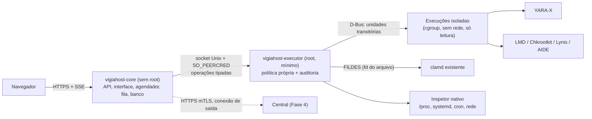

# Escopo v2 — VigiaHost, plataforma de segurança para servidores Linux

> **Versão 2.3 · 22/10/2026 · Status: proposta para aprovação.** Base: escopo v1 de 21/10/2026. A v2.1 incorporou a revisão final de arquitetura, segurança, interface e acessibilidade; a v2.2 registrou as decisões de nome, repositório, distribuição e chaves; a v2.3 torna o projeto **software livre sob GPL-3.0, em repositório público** (histórico no Anexo A).
> Documentos relacionados: [plano de implementação](plano-implementacao.md) e [decisões de arquitetura](decisoes-arquitetura.md).
> Nada foi implementado: código, repositório remoto e instalador ainda não existem.
> As versões de ferramentas e bibliotecas citadas foram conferidas em 22/10/2026 nas fontes da seção 25. **VigiaHost** é o nome do produto; `vigiahost` é o identificador técnico (binários, pacotes, serviços, usuário do sistema e diretórios).

---

## 1. Resumo das principais mudanças

A arquitetura da v1 (Go + React embarcado + SQLite, executor separado, adaptadores, central opcional) **está mantida**. As mudanças abaixo corrigem lacunas reveladas pelo caso real que originou o projeto, aproveitam recursos atuais das ferramentas e reduzem custo de implementação e de operação.

| # | Mudança | Motivo principal |
|---|---|---|
| 1 | **Novo módulo nativo de inspeção de processos e persistência** | No caso real, o backdoor root executado a partir de memória (`memfd`) não foi reconhecido pelo antivírus nem pelas regras YARA públicas; foi encontrado pela relação processo → cgroup → unidade systemd. Varredura de arquivos não cobre esse cenário. |
| 2 | **YARA-X como motor principal de regras**, distribuído pelo produto; YARA 4.x opcional | O YARA original está em manutenção (apenas correções) desde o YARA-X estável de jun/2025. As distribuições trazem YARA de 4.1.3 a 4.5.5, o que torna o comportamento das regras desigual. |
| 3 | **Inventário único com distribuição para os motores** e cache de resultados | Hoje cada ferramenta percorre o disco separadamente; o inventário único reduz I/O, permite progresso real e cobertura comparável entre motores. |
| 4 | **Cliente nativo do protocolo do clamd**, com passagem de descritor de arquivo | Progresso, pausa e cancelamento sob nosso controle; detecção vinculada ao objeto exato (inode + hash); o clamd não precisa de permissão de leitura nos arquivos. |
| 5 | **Cada execução em unidade systemd transitória** | Limites por cgroup, cancelamento do grupo inteiro, pausa universal por *freezer*, recuperação após reinício do executor e isolamento (sem rede, somente leitura). |
| 6 | **Resultado em três dimensões: estado da execução, achados e cobertura** | Um único estado misturava "falhou", "parcial" e "encontrou algo". Achados passam a ser agrupados por objeto (hash) e por fonte de assinatura. |
| 7 | **Executor com política própria**, assumindo que o serviço web pode estar comprometido | O executor roda como root; validar só no serviço web não protege contra a escalada a partir dele. |
| 8 | **Repositórios APT/DNF assinados como canal principal de distribuição** | Atualização nativa, sem reinventar o gerenciador de pacotes. TUF passa a cobrir autoatualização por tarball e a central. |
| 9 | **Agendador orientado ao banco** no lugar do gocron como fonte de verdade | Durabilidade, política explícita para horários perdidos e deduplicação por chave única. |
| 10 | **Triagem automática das diferenças do AIDE** | No caso real, centenas de alterações precisaram ser correlacionadas manualmente com atualizações de pacotes e do painel. |
| 11 | **Central sem Next.js**: uma única pilha React compartilhada | Evita manter duas pilhas de interface; o painel local e a central reutilizam os mesmos componentes. |
| 12 | **Entregas replanejadas** (Fase 0 de fundação, Fase 1 dividida em 1A e 1B, critérios de saída, hospedagem e tempo real em fase própria) | A Fase 1 da v1 concentrava risco demais; o módulo de processos e persistência sobe para a primeira entrega. |
| 13 | **Contas do servidor como unidade de escopo**: lista, verificação e achados por conta, no modelo de uso do Imunify | Hospedagem é administrada por conta; verificar por conta encurta a investigação e permite priorizar as de maior risco |
| 14 | **Perfis de recursos configuráveis**, com travas aplicadas pelo executor | Servidores pequenos precisam de proteção contra sobrecarga; servidores grandes precisam poder liberar recursos |
| 15 | **Otimização sistemática das tarefas** (incremental, cache, deduplicação, roteamento por tipo, leitura única) | A rotina diária passa a tocar uma fração do disco, com menos impacto nos sites |
| 16 | **Verificações complementares**: correções de segurança pendentes, serviços a reiniciar, processos ocultos, dependências de aplicações, WordPress, logs de acesso e Falco opcional | Malware é consequência; a porta de entrada e o comportamento em tempo real completam a investigação |
| 17 | **Interface com vocabulário único, ciclo de vida do achado e acessibilidade verificável** | A revisão do preview mostrou severidade misturada com estado, além de lacunas de foco e teclado |

---

## 2. Lições do caso real convertidas em requisitos

O projeto nasceu de um atendimento com servidor comprometido e migração para um novo ambiente. Os fatos abaixo (sem dados do cliente) foram observados nesse trabalho e viram requisitos do produto.

| Observação | Requisito no produto |
|---|---|
| Backdoor root em `memfd`, sem arquivo correspondente em disco, não reconhecido por ClamAV nem por 1.894 regras YARA públicas | Inspetor de processos: executáveis `memfd`/apagados, binários fora de pacote, extração de `/proc/<pid>/exe` para hash e varredura (seção 8) |
| Unidade maliciosa `Type=oneshot` aparecia **inativa**, mas mantinha vínculo de boot e o processo vivo no seu cgroup | Inventário de persistência pelo conteúdo (`ExecStart`, propriedade de pacote, vínculo de boot), não pelo estado ativo |
| Busca por indicadores conhecidos não encontrou a persistência; a correlação pelo cgroup encontrou | Correlação processo ↔ cgroup ↔ unidade ↔ arquivo ↔ conexões de rede |
| Seis arquivos com o mesmo hash de minerador ("não são seis malwares") | Achados agrupados por **objeto** (SHA-256) com várias localizações |
| Atributo imutável (`chattr +i`) impediu a remoção | Quarentena detecta atributos imutáveis/append-only e exige ação explícita, só no caminho exato |
| Chkrootkit marcou `chsh` (string `/bin/sh`), porta 2002 de painel legítimo e falhou no teste de `sshd` da 0.59 | Base de falsos positivos conhecidos com validação contextual e verificação contra **pacote assinado do repositório** |
| Regra genérica de webshell marcou middleware Laravel legítimo | Exceção preferencial por **hash** (ou hash + regra), nunca por regra global ou caminho amplo |
| Socket do PostgreSQL em `/tmp` gerou aviso do ClamAV | Objetos não regulares (socket, FIFO, dispositivo) classificados como ignorados com motivo, sem poluir avisos |
| Vídeo acima do limite exigiu varredura complementar com limites maiores | Fila automática de "arquivos acima do limite", com limites e recursos próprios |
| Limites efetivos do clamd (100 MiB, 400 MiB agregados, recursão 17, `AlertExceedsMax` desligado) reduzem cobertura sem aviso | Leitura e exibição dos limites efetivos; cobertura por motor; alerta de limite quando possível |
| Maldet integrado ao clamd + execução nativa repetiria o mesmo motor | Desligar o estágio ClamAV do LMD quando o clamd é varrido diretamente; contagem de confirmações por **fonte de assinatura** |
| 223 alterações do AIDE coincidiam com tarefas de atualização do painel e de pacotes | Triagem automática: alteração explicada por pacote assinado/histórico do gerenciador ou do painel |
| Lynis instalado em `/usr/bin` (não `/usr/sbin`) e procurando a base padrão do AIDE | Adaptadores descobrem caminhos e configuram integrações entre ferramentas |
| Catálogo do painel oferecia Maldet de 2013 | Política de versão mínima e fonte confiável por ferramenta |
| Testes com EICAR e marcadores inertes validaram motores; código zero do runner não provava resultado | **Autoteste (controle positivo) antes de cada execução** e avaliação individual de cada motor |

---

## 3. Objetivo, não objetivos e premissas

**Objetivo.** Reunir em uma interface própria a configuração das ferramentas, verificações, resultados, cobertura, agendamentos, atualizações, alertas e tratamento das detecções em servidores Linux puros ou com painéis de hospedagem, com instalação por um comando e evolução para administração de vários servidores.

**Não objetivos (nas fases previstas).**

- Não é um EDR com bloqueio em tempo real nem promete detectar ameaças desconhecidas.
- Não substitui WAF (ModSecurity), firewall (CSF/firewalld/nftables), backup das aplicações nem perícia formal com cadeia de custódia.
- Não envia amostras ou arquivos a serviços externos; consultas externas opcionais enviam apenas metadados declarados (ex.: versão de CMS).
- Não altera configurações de painéis, serviços ou firewall silenciosamente; mudanças no sistema ficam registradas e são reversíveis.
- Não restaura a confiança de um sistema comprometido com root: o produto ajuda a encontrar e remover artefatos, e a recomendação continua sendo reconstruir a partir de fontes confiáveis.

**Premissas.** Servidores com systemd; acesso root para instalar; Go e Node apenas no desenvolvimento; scanners como processos externos.

---

## 4. Requisitos não funcionais (metas a validar na homologação)

| Requisito | Meta inicial | Observação |
|---|---|---|
| Consumo do produto ocioso (serviço web + executor, sem scanners) | < 100 MiB RSS e CPU próxima de zero | Medido em cada release |
| Impacto em produção | Sem degradação perceptível dos sites durante verificações | Medir latência p95 de um site de referência com e sem limitação por PSI |
| Requisitos mínimos | 2 vCPU e 2 GiB RAM sem clamd; reservar memória adicional para o clamd | O clamd mantém as assinaturas em memória e, com recarga concorrente, pode carregar um segundo motor temporariamente; valor exato a medir por versão |
| Escala local | 1 milhão de arquivos por servidor sem degradar o banco | Inventário detalhado fora do SQLite (seção 17) |
| Disponibilidade | Agendamentos e execuções retomam após reinício do serviço ou do servidor | Reconciliação pelo nome da unidade transitória |
| Atualização | Atualização com verificação de saúde e retorno à versão anterior documentado | Migrações compatíveis com a versão anterior |
| Segurança | Nenhuma operação privilegiada sem passar pela política do executor | Testes de autorização cobrindo 100% dos endpoints × perfis |
| Privacidade | Nenhuma telemetria por padrão | Decisão pendente (seção 23) |
| Escala de contas | Lista com 5.000 contas, filtros e ordenação em < 2 s | Agregados por conta atualizados de forma incremental |
| Interface | Listas paginadas em < 300 ms (p95) no servidor de referência; uso pleno com 200% de zoom | Medido no corpus de desempenho |
| Acessibilidade | WCAG 2.1 AA; nenhuma violação grave do axe-core nos fluxos E2E | Teste manual com teclado e leitor de tela (NVDA ou Orca) a cada fase |

---

## 5. Compatibilidade

### 5.1 Níveis de suporte propostos

| Nível | Sistemas | Compromisso |
|---|---|---|
| **1 — Homologado** | Ubuntu 24.04 e 26.04 LTS; Debian 12 (em LTS) e 13; AlmaLinux e Rocky Linux 9 e 10 | CI completo em VM, todas as funções, x86_64 e ARM64 conforme disponibilidade dos motores |
| **2 — Suportado com limitações** | Ubuntu 22.04; AlmaLinux/Rocky 8; CentOS Stream 9 e 10 | Funções dependentes de cgroup v2, AIDE ≥ 0.18 ou systemd recente podem ficar indisponíveis, com justificativa na interface. Stream é *rolling* e recebe testes reduzidos |
| **Fora** | CentOS Linux 7/8, Ubuntu ≤ 20.04, Debian ≤ 11 | Sem suporte; eventual modo somente leitura a avaliar |

AlmaLinux 10 usa x86-64-v3 por padrão (há variante v2). O binário Go deve manter `GOAMD64=v1` para não restringir hardware.

### 5.2 Versões disponíveis nas distribuições

Dados do Repology em 22/10/2026. Quando aparecem duas versões, a distribuição publica ambas (lançamento e atualização); o produto deve conferir a versão efetivamente instalada. "—" indica pacote não encontrado nos repositórios oficiais/EPEL; "a confirmar" indica dado ausente na consulta.

| Ferramenta | Ubuntu 22.04 | Ubuntu 24.04 | Ubuntu 26.04 | Debian 12 | Debian 13 | EL 8 | EL 9 | EL 10 | Upstream |
|---|---|---|---|---|---|---|---|---|---|
| ClamAV | 0.103.5 / 1.5.4 | 1.0.5 / 1.5.4 | 1.4.3 / 1.5.4 | 1.4.3 | 1.4.3 | 1.4.6 (EPEL) | 1.4.6 (EPEL) | 1.4.6 (EPEL) | 1.5.4; LTS 1.4.6 |
| YARA | 4.1.3 | 4.5.0 | 4.5.5 | 4.2.3 (4.5.2 backports) | 4.5.2 | 4.2.3 | 4.5.2 | 4.5.2 | YARA-X 1.22.0 |
| AIDE | 0.17.4 | 0.18.6 | a confirmar | 0.18.3 | 0.19.1 | a confirmar | 0.19.2 | 0.19.2 (Stream) | 0.19.4 |
| Lynis | 3.0.7 | 3.0.9 | 3.1.6 | 3.0.8 | 3.1.4 | 3.1.7 (EPEL) | 3.1.7 (EPEL) | 3.1.7 (EPEL) | 3.1.7 |
| Chkrootkit | 0.55 | 0.58b | 0.58b | 0.57 | 0.58b | — | — | — | 0.59 |
| Rkhunter | 1.4.6 | 1.4.6 | 1.4.6 | 1.4.6 | 1.4.6 | 1.4.6 | 1.4.6 | 1.4.6 | 1.4.6 (2018) |

**Consequências para o produto:**

- **ClamAV:** exigir no mínimo a série **1.4 LTS** (suporte até 15/08/2027). A série 1.0 LTS só baixa assinaturas até **28/11/2026**; versões ≤ 0.105 já estão bloqueadas. O instalador deve detectar a versão efetiva, inclusive a do painel, e oferecer o pacote oficial (DEB/RPM x86_64 e aarch64, com assinatura `.sig`) quando a da distribuição for inadequada.
- **YARA:** a variação de versões justifica distribuir o YARA-X pelo próprio produto (binários oficiais Linux x86_64 e aarch64, glibc).
- **AIDE:** relatório JSON/NDJSON (`report_format`) e paralelismo (`num_workers`) existem a partir da 0.18. Ubuntu 22.04 e EL8 exigem leitura do formato texto ou ficam com função limitada. A 0.19 trocou opções de configuração (`database` → `database_in`) e o hash padrão (md5 → sha3_256).
- **Chkrootkit:** não há pacote para EL. O produto precisa de um pacote próprio da 0.59 (fonte verificada por hash) ou declarar a função como indisponível nesses sistemas.

### 5.3 Capacidades que dependem do sistema

| Capacidade | Requisito | Quando ausente |
|---|---|---|
| Pausa universal de execuções | cgroup v2 + systemd com *freeze* | Pausa apenas onde o produto controla a alimentação de arquivos (clamd nativo) |
| Limitação adaptativa de carga | PSI (`/proc/pressure/*`) | Limites fixos; em EL8 o PSI pode exigir parâmetro de boot |
| Limite de I/O previsível | `io.max` (cgroup v2) | `ionice`/peso de I/O, cuja eficácia depende do escalonador de disco |
| Segredos via systemd | `LoadCredential` (systemd ≥ 247) | Arquivo 0600 dedicado |
| Monitoramento contínuo (Fase 3) | fanotify em kernel recente | inotify com limites de *watches* + reconciliação periódica |
| Restrição adicional do serviço web | Landlock (kernel ≥ 5.13) | Apenas *hardening* do systemd |
| Confinamento | Política SELinux própria / perfil AppArmor | Execução em modo permissivo documentada |
| Detecção comportamental com Falco (opcional, Fase 3) | Driver eBPF moderno (padrão do Falco): kernel com BTF e *ring buffer* BPF, em geral ≥ 5.8 (alguns kernels anteriores têm *backport*); conferido na ativação | Função indisponível com motivo; o módulo de kernel do Falco não é usado |
| Dados de contas do painel (Fase 3) | Adaptador do painel com API documentada | Contas por `getent passwd` e `UID_MIN` |

EL8 usa cgroup v1 por padrão, kernel 4.18 e systemd 239. Por isso fica no nível 2.

### 5.4 Painéis e coexistência

- **Detecção desde a Fase 1A** (somente leitura): Webuzo, cPanel/WHM, Plesk, DirectAdmin, CWP, CyberPanel, HestiaCP, aaPanel, ISPConfig e Virtualmin.
- **Ferramentas concorrentes ou sobrepostas** a reconhecer e respeitar: ImunifyAV/Imunify360, cPGuard, monitor residente e cron diário do Maldet, freshclam do painel, CSF/LFD, agendamentos e travas de segurança preexistentes.
- **Integração específica (Fase 3):** contas, donos e caminhos de sites pela API documentada de cada painel, sem alterar a configuração do painel.

---

## 6. Arquitetura

### 6.1 Processos e limites de confiança



- **`vigiahost-core`**: usuário próprio sem privilégios. API, interface embarcada, agendador, fila, banco, notificações.
- **`vigiahost-executor`**: binário separado e mínimo (sem servidor HTTP nem interface embarcada), executado como root. Aceita somente operações tipadas por um socket Unix com permissão restrita e conferência do UID do processo cliente (`SO_PEERCRED`). **Aplica política própria**: caminhos permitidos por escopo configurado, bloqueio de caminhos críticos do sistema sem política explícita, limites de taxa para ações destrutivas e registro próprio no journal.
- **Execuções**: unidades systemd transitórias criadas pelo executor via D-Bus, com nome determinístico (`vigiahost-run-<id>.service`), limites e isolamento por motor.
- **Motores**: sempre processos externos; arquivos potencialmente maliciosos nunca são interpretados dentro do processo root do executor.
- **Compatibilidade core–executor**: protocolo versionado com *handshake*; os dois binários vêm no mesmo pacote e o executor recusa versão principal diferente. A atualização do pacote reinicia apenas os serviços do produto, nunca o clamd, o servidor web ou serviços do painel.

### 6.2 Pipeline de varredura unificado

1. **Inventário**: percurso único do escopo, sem seguir links simbólicos, sem atravessar pontos de montagem salvo seleção, com exclusão padrão de FUSE, NFS/CIFS e pseudo-sistemas de arquivos.
2. **Classificação**: arquivo regular, link, socket, FIFO, dispositivo; tamanho; tipo pelo conteúdo (*magic bytes*), não pela extensão; nomes com caracteres de controle ou bidi viram indicador próprio.
3. **Cache**: chave `(dispositivo, inode, tamanho, mtime, ctime)` + versão de assinaturas/regras de cada motor. Objeto inalterado e já analisado com as mesmas versões não é relido. A seleção incremental usa `ctime`, que não pode ser ajustado pelo usuário como o `mtime` (*timestomping*).
4. **Distribuição**: o mesmo descritor é enviado ao clamd por FILDES; o YARA-X recebe lista de arquivos ou conteúdo; o LMD recebe lista quando habilitado. Arquivos acima do limite seguem para fila própria.
5. **Normalização e correlação**: achados por objeto, fonte de assinatura e motor; cobertura por motor; avaliação de exceções.

O inventário prévio permite **progresso real** (arquivos e bytes elegíveis × processados). Para ferramentas sem progresso granular (Chkrootkit, Lynis, AIDE em versões antigas), a interface mostra atividade e tempo decorrido, com duração típica do histórico rotulada como estimativa.

### 6.3 Stack consolidada

| Camada | v1 | v2 | Motivo |
|---|---|---|---|
| Linguagem | Go | **Go 1.27** (mínimo 1.26), `CGO_ENABLED=0` nos binários principais | Cada versão principal é suportada até sair a segunda seguinte; 1.27 saiu em 19/08/2026. Binário estático evita dependência de glibc em sistemas antigos |
| Recursos da linguagem | — | `os.Root` (acesso limitado a diretório), `http.CrossOriginProtection` (CSRF), `GOMAXPROCS` ciente de cgroup, `testing/synctest`, diretiva `tool` no `go.mod` | Reduzem dependências externas e código próprio de segurança |
| HTTP/API | net/http + Chi | Mantido | — |
| Contrato | OpenAPI + oapi-codegen | Mantido (**v2.8.0**, suporte inicial a OpenAPI 3.1) + **cliente TypeScript gerado** do mesmo contrato | Evita divergência entre interface e API; manter 3.0.3 enquanto o suporte a 3.1 for parcial |
| Banco local | SQLite + modernc.org/sqlite | Mantido, com WAL, `busy_timeout`, um único escritor, tabelas `STRICT`, FTS5 para busca | Concorrência previsível |
| Consultas / migrações | sqlc / Goose | Mantidos; migrações compatíveis com a versão anterior e backup automático antes de migrar | Permite retornar à versão anterior |
| Agendamento | gocron | **Agendador orientado ao banco** (expressão cron + `next_run_at` persistido + política para horários perdidos); gocron opcional apenas como interpretador | Fonte de verdade durável; sem estado só em memória |
| Fila | Tarefas no SQLite + workers | **Tabela de jobs com *lease*, *heartbeat*, chave de idempotência e máquina de estados**; goqite como referência/alternativa | Recuperação após falha e deduplicação |
| Execução | systemd/cgroups | **Unidades transitórias via D-Bus** (`coreos/go-systemd`) | Limites, cancelamento, pausa e reconciliação |
| Motor de regras | YARA (YARA-X depois) | **YARA-X 1.22 via CLI `yr`** (regras pré-compiladas, saída NDJSON); YARA 4.x opcional para memória de processos | Seção 7 |
| Antivírus | ClamAV | **Cliente nativo do protocolo clamd** + `clamscan` para arquivos acima do limite | Seção 7 |
| Tempo real na interface | SSE | Mantido, com `Last-Event-ID` e HTTP/2 | Retomada após queda e sem limite de conexões por origem do HTTP/1.1 |
| Logs | log/slog | Mantido, JSON no journal | Escapa nomes de arquivo maliciosos |
| Sessões e MFA | Argon2id, MFA | Sessões no servidor (ex.: `alexedwards/scs`), TOTP + **passkeys/WebAuthn** (`go-webauthn`), códigos de recuperação | MFA resistente a phishing |
| Distribuição | GoReleaser + nFPM | Mantidos + **repositórios APT/DNF assinados**, cosign, SBOM e proveniência | Seção 15 |
| Atualização segura | TUF | **go-tuf v2** para tarball e central (Fase 2+) | Repositórios assinados cobrem a instalação por pacote |
| Interface | React + Vite + React Router + shadcn/ui + Tailwind + TanStack Query/Table + RHF + Zod + Recharts | Mantidos + cliente gerado (openapi-typescript/openapi-fetch ou Orval), i18n (react-i18next ou Lingui), TanStack Virtual, Vitest, Playwright com axe-core, MSW, eslint-plugin-jsx-a11y | Seção 14 |
| Design system | — | Tokens CSS (cor, tipografia, espaçamento, raio) para tema claro e escuro, mapeados no Tailwind; componentes de domínio documentados; fontes e ícones SVG embarcados, sem CDN | Seção 14 |
| Central | PostgreSQL, Go + React ou Next.js | **PostgreSQL + Go + mesma pilha React**; protocolo agente–central com protobuf (ConnectRPC) | Seção 18 |

---

## 7. Motores e adaptadores

### 7.1 Contrato do adaptador

Cada adaptador implementa: **descoberta** (caminho, versão, quem gerencia: distribuição, painel ou produto), **capacidades** (formato de saída, progresso, pausa, limites, memória de processos), **saúde e autoteste**, **configuração efetiva** (inclusive limites), **atualização** (motor, assinaturas, regras), **execução** com argumentos fixos e **interpretação** preferencialmente de formatos estruturados.

> **Saída textual é entrada controlada pelo atacante.** Um arquivo chamado `x\n/var/www/limpo.php: OK` pode forjar linhas da saída de um scanner. Preferir protocolo binário/estruturado (clamd, NDJSON, JSON); quando só houver texto, usar separadores nulos, uma consulta por arquivo ou validação cruzada com o inventário. Os interpretadores passam por *fuzzing* (seção 20).

### 7.2 Ferramentas

| Ferramenta | Papel | Integração v2 | Observações |
|---|---|---|---|
| **ClamAV** | Assinaturas, inclusive as do LMD carregadas no clamd | Cliente nativo do socket Unix: `VERSION`, `STATS`, `FILDES` (passagem do descritor), `INSTREAM` para conteúdo extraído; `clamscan` com limites maiores para a fila de arquivos grandes | Concorrência limitada contra o clamd compartilhado (que também atende e-mail); não reiniciar nem reconfigurar o clamd do painel; ler e exibir `MaxFileSize`, `MaxScanSize`, `MaxRecursion`, `MaxFiles`; um único freshclam |
| **YARA-X** | Regras específicas e personalizadas | Binário `yr` distribuído pelo produto em pacote próprio; `yr compile` + varredura com regras pré-compiladas, lista de arquivos e saída NDJSON; `--cpu-limit` disponível | Incompatibilidades com YARA 4.x (ex.: `{` sem escape em regex, escapes inválidos, base64 com menos de 3 caracteres) tratadas na compilação; `--relaxed-re-syntax` só como transição. A biblioteca Go exige a biblioteca C (cgo), por isso a CLI é preferida |
| **YARA 4.x** (opcional) | Memória de processos por PID | Usado somente pelo inspetor de processos (Fase 3) | A documentação do YARA-X não descreve varredura de processos |
| **LMD 2.0.1** | Assinaturas e rotinas voltadas a hospedagem; *hooks* de upload (Fase 3) | `--json-report`; alimentado por lista do inventário; estágio ClamAV desligado quando o clamd já é varrido; alertas próprios desligados (o produto notifica) | A 2.0 removeu Perl, tem estágio YARA/YARA-X e mudou formatos (`scanid` → `scan_id`). Medir em laboratório a sobreposição com as assinaturas rfxn carregadas no clamd antes de manter as duas passagens por padrão |
| **AIDE** | Integridade contra referência aprovada | Configuração dedicada do produto; `report_format=json`/`ndjson` (≥ 0.18), `num_workers`; código de saída como máscara (1 novos, 2 removidos, 4 alterados; ≥ 14 erros) | Triagem automática (seção 10); referência com hash, cópia exportável e aprovação explícita |
| **Verificação de pacotes** | Conferir binários contra o pacote | `rpm -V`/`dpkg --verify` e, para alertas, comparação com o **pacote assinado baixado do repositório** (assinatura verificada, conteúdo extraído sem instalar) | O `md5sums` do dpkg não é assinado; a comparação com o pacote resolve isso |
| **Chkrootkit 0.59** | Indícios complementares de rootkit | Execução isolada; saída interpretada com base de falsos positivos conhecidos validados por contexto (hash igual ao pacote assinado, dono do *listener*, versão do teste) | Sem pacote EL; pacote próprio ou função indisponível |
| **Lynis 3.1.7** | Auditoria de configuração | `--report-file`; leitura do `report.dat`; descoberta do caminho do binário | Índice de endurecimento não prova segurança; sugestões nunca aplicadas automaticamente |
| **auditd** | Eventos e contexto de alterações | Regras do produto em arquivo próprio em `rules.d`, sem apagar regras alheias; leitura com `go-libaudit`; monitorar `lost`/`backlog` | Opcional e reversível |
| **Rkhunter** | — | Fora do padrão | Última versão do projeto em 2018 |

### 7.3 Fontes de regras YARA e licenças

- **Não embarcar regras de terceiros no pacote.** O produto baixa no servidor do cliente as fontes que o administrador habilitar, fixando *commit* ou release, conferindo hash, compilando e testando antes de promover.
- **Signature-Base** usa a *Detection Rule License 1.1*: ao exibir correspondências, é preciso manter autor e referência da regra. A interface mostrará **autor, fonte, licença e link** em cada achado.
- **Elastic protections-artifacts** usa a *Elastic License 2.0* (não sublicenciável, com restrições de uso como serviço). Requer avaliação jurídica antes de uso comercial.
- **YARA Forge** publica pacotes semanais (core/extended/full) a partir de dezenas de fontes; release mais recente em 18/10/2026. Candidato a fonte padrão, sujeito à validação de licenças e de compatibilidade com YARA-X.
- **Promoção de regras**: download → verificação → compilação → controle positivo → corpus benigno (CMS e frameworks populares) para medir falsos positivos → troca atômica → conjunto anterior guardado para retorno. A versão do conjunto é registrada em cada execução.
- **Regras de terceiros são entrada não confiável**: compilação e testes em unidade isolada com limites de CPU, memória e tempo; inclusão de arquivos restrita ao diretório da própria fonte; limite de tempo por arquivo na varredura; regra que estoura o limite no corpus de desempenho fica desativada até revisão.

### 7.4 Autoteste de motores

Antes de cada execução, cada motor analisa um **controle positivo** inofensivo (EICAR por `INSTREAM`, marcador YARA inerte) e um negativo. Falha no controle marca a execução como **falha de motor**, evitando o cenário de clamd sem assinaturas ou regras não carregadas reportando "sem detecções".

### 7.5 Ferramentas e verificações complementares

As ferramentas anteriores encontram **malware**. As lacunas restantes são **vulnerabilidades** (a porta de entrada), **comportamento em tempo real** e **contexto** para a investigação.

| Prioridade | Ferramenta ou verificação | O que acrescenta | Fase | Custo e cuidados |
|---|---|---|---|---|
| 1 | Pacotes do sistema com correção de segurança pendente (`dnf updateinfo` / atualizações de segurança do APT) | Mostra o que está vulnerável e sem atualização | 2 | Nativo do gerenciador de pacotes; nenhuma dependência nova |
| 2 | Serviços com bibliotecas ou kernel antigos em uso (`needrestart` / `dnf needs-restarting`) | Atualização instalada mas ainda não efetiva, como o kernel aguardando reinício no caso real | 2 | Pacotes nas distribuições e no EPEL; somente leitura |
| 3 | Processos e portas ocultos (técnica do unhide, implementada no inspetor) | Indício de rootkit: PID ou porta acessível diretamente, mas ausente das listagens | 2 | Nativo em Go; o unhide não tem pacote para EL |
| 4 | OSV-Scanner (Google, Apache-2.0) | Vulnerabilidades nas dependências das aplicações (`composer.lock`, `package-lock.json` etc.) com base offline | 3 | Binário Go; base baixada periodicamente; nada do servidor é enviado |
| 5 | Wordfence Intelligence (feed de vulnerabilidades do WordPress) | Plugins e temas vulneráveis por site e por conta | 3 | Gratuito inclusive para uso comercial, com chave gratuita e atribuição obrigatória na interface |
| 6 | Correlação com logs de acesso web | Para cada arquivo suspeito: quem acessou, quando, se recebeu POST e quando apareceu | 3 | Nativo; leitura dos logs do Apache, Nginx ou do painel |
| 7 | Falco (CNCF, Apache-2.0), opcional | Detecção comportamental em tempo real via eBPF: execução sem arquivo por `memfd_create` (regra padrão), shell iniciado pelo servidor web e *reverse shell* (regras *sandbox*) | 3 | Agente residente; custo cresce com o volume de chamadas de sistema; driver eBPF moderno exige kernel recente |
| 8 | Listas de indicadores da abuse.ch (hashes, URLs, IPs de C2), opcional | Conferir hashes e conexões de saída contra indicadores conhecidos | 3 | Chave gratuita e regras de uso justo; confirmar termos para uso comercial; consulta local, sem enviar dados do servidor |

**Não recomendados agora:** Trivy (releases e GitHub Actions comprometidos entre fevereiro e março de 2026; se adotado no futuro, fixar versão e verificar assinatura); Rkhunter (sem release desde 2018); LKRG (módulo de kernel, risco de estabilidade em produção); osquery e agente Wazuh (sobrepõem o inspetor nativo; integrar via SIEM, seção 16). OpenSCAP apenas se houver demanda de conformidade formal (CIS, PCI-DSS), já que o Lynis cobre o endurecimento geral.

**Regras de integração.** Nenhuma exige outra aplicação além do Falco (opcional). Chaves de feeds são segredos (seção 13); bases e listas são baixadas por unidade separada com rede, verificadas e versionadas, e as consultas são sempre locais. O Falco roda como serviço próprio e privilegiado, fora do executor: o produto só o instala e ativa por opção explícita, lê os eventos como entrada não confiável e não permite editar regras arbitrárias pela interface. Sem essas integrações, o restante do produto funciona normalmente.

---

## 8. Inspeção de processos e persistência (novo, Fase 1A)

Módulo nativo em Go, **somente leitura**, executado pelo executor.

**Processos e rede**

- Executável `memfd:` ou apagado (`(deleted)`), em `/tmp`, `/var/tmp`, `/dev/shm` ou diretórios de usuários; extração de `/proc/<pid>/exe` para hash e varredura (YARA-X/ClamAV).
- Binário fora de qualquer pacote, nomes que imitam *threads* do kernel com executável em disco, `LD_PRELOAD` no ambiente.
- Árvore de processos: servidor web ou PHP-FPM originando shell/interpretador; processos de usuários de hospedagem com alto consumo de CPU (indício de mineração).
- Cgroup → unidade systemd; sockets em escuta e conexões de saída por processo (netlink `sock_diag`), com destaque para processos sem arquivo em disco.

**Persistência** (inventário + diferença em relação ao anterior)

- Unidades e *timers* systemd (sistema e usuários), geradores, `ExecStart` fora de pacote, vínculos em `*.wants`.
- Cron (sistema, `/etc/cron.*`, `/var/spool/cron`), `at`, `rc.local`, `init.d`, `profile.d`, arquivos de inicialização de shell.
- `/etc/ld.so.preload`, `ld.so.conf.d`, módulos PAM fora de pacote, `sshd_config` (`AuthorizedKeysCommand`), `authorized_keys` de todos os usuários, `sudoers.d`, regras udev com `RUN+=`, módulos de kernel carregados e *taint*.

**Resultados**: achados com categoria (persistência, processo suspeito, rede), evidências (instantâneo de `status`, `maps`, `cgroup`, `cmdline` com mascaramento de segredos) e vínculos entre itens. Ações de resposta são da Fase 2 (seção 11). A varredura da memória por PID com YARA 4.x fica na Fase 3.

---

## 9. Contas do servidor e hospedagem

### 9.1 Contas do servidor e verificação por conta (Fase 1B, ampliada na Fase 3)

Modelo de uso semelhante ao do Imunify: uma lista de contas com situação de cada uma, verificação de todas ou de uma conta específica e achados agrupados por conta. "Conta" é o usuário do sistema ou da hospedagem dono de arquivos e processos, diferente dos usuários do painel do produto (seção 13).

**Descoberta**

- **Sem painel (Fase 1B):** `getent passwd` (inclui LDAP/SSSD), com contas de hospedagem/humanas filtradas por `UID_MIN` de `/etc/login.defs` e diretório pessoal válido; contas de sistema visíveis por filtro.
- **Com painel (Fase 3):** domínios, docroots fora do diretório pessoal, revendedor, situação (ativa/suspensa) e versão de PHP pela API documentada do painel.
- **Atribuição sem nova leitura do disco:** inventário, processos, cron, unidades de usuário e chaves SSH já registram o UID; o produto agrega por conta.

**Tela Contas**

| Coluna | Origem |
|---|---|
| Conta, diretório pessoal, domínios | Sistema / painel |
| Arquivos e espaço | Último inventário |
| Achados abertos por severidade | Achados atribuídos ao UID ou ao caminho da conta |
| Última verificação e cobertura | Execuções da conta |
| Processos ativos e persistência própria (cron, unidades de usuário, `authorized_keys`) | Inspetor de processos e persistência |
| Situação | Painel (quando houver) |

Ações: **verificar todas**, **verificar a conta**, abrir o detalhe (achados, execuções, processos, persistência e exceções da conta), ordenar e filtrar por risco.

**Verificação por conta.** O escopo é montado automaticamente: diretório pessoal, docroots fora dele, arquivos do UID em `/tmp`, `/var/tmp` e `/dev/shm`, cron e unidades do usuário, processos e conexões do UID e chaves SSH. Também permite várias contas por vez, agendamento por conta (ex.: diário para as de maior risco), exclusões e perfil de recursos próprios. Em servidores grandes, as contas viram unidades de paralelismo e de prioridade (seção 12.1).

**Diferenças deliberadas em relação ao Imunify:** limpeza e quarentena automáticas desligadas por padrão; nenhuma ação sobre a conta (suspensão, bloqueio, aviso ao titular) acontece sozinha; aviso ao titular só com destinatário configurado explicitamente. Restaurar o original de arquivos do núcleo de CMS a partir da fonte oficial é opção da Fase 3, sempre com aprovação.

**Acesso de revendedores e clientes** à própria conta (como o plugin do usuário final em painéis) depende da decisão sobre multiempresa e fica para a Fase 3/4.

### 9.2 Verificações específicas de hospedagem (Fase 3)

- PHP em diretórios de upload; `.htaccess` que tornam imagens executáveis ou redirecionam para domínios externos.
- `auto_prepend_file`/`auto_append_file` em `php.ini`, `.user.ini` e `.htaccess` (persistência comum em hospedagem).
- Extensões duplas (`.jpg.php`), arquivos PHP ocultos, nomes com caracteres de controle.
- Integridade de CMS: checksums oficiais do núcleo e plugins do WordPress (opcional; envia apenas versão e idioma), começando pelo WordPress e expandindo conforme demanda.
- Postura: diretórios graváveis por todos em webroots, `noexec` em `/tmp` e `/dev/shm`, `disable_functions` por pool.
- Arquivos sensíveis expostos no docroot: `.env`, diretórios `.git`, dumps `.sql` e backups compactados acessíveis pela web.
- Correlação com logs de acesso e vulnerabilidades de aplicações e de WordPress (seção 7.5).
- Lista de conhecidos por proveniência (hash idêntico ao pacote assinado ou ao checksum oficial do CMS) para reduzir falsos positivos de regras genéricas e tempo de varredura, sem dispensar o antivírus.

---

## 10. Resultados, cobertura e correlação

**Entidades.** Execução → execução por motor → cobertura → **objeto** (SHA-256, tamanho, tipo) → **localizações** (caminho, dispositivo, inode, dono, modo, `mtime`/`ctime`) → **achados** (motor, versão do motor, versão de assinaturas/regras, regra, fonte, licença, categoria, severidade) → veredito e revisão.

**Três dimensões por execução** (substituem o estado único da v1):

| Dimensão | Valores |
|---|---|
| Estado da execução | Concluída, parcial, falha, falha de motor, cancelada, interrompida e recuperada |
| Achados | Sem achados, achados para revisão, ameaça confirmada (por revisão ou política) |
| Cobertura | Elegíveis, analisados, ignorados por motivo (exclusão, tamanho, tipo, permissão, objeto não regular, alterado durante a leitura, limite de compactados, tempo), por motor |

**Regras de correlação**

- Mesma fonte de assinatura detectada por dois motores (ex.: assinatura rfxn via clamd e via LMD) conta como **uma** evidência.
- "Confirmação independente" exige fontes distintas ou revisão humana, nunca apenas dois motores.
- Objeto com várias cópias aparece uma vez, com todas as localizações.
- Cada execução informa as exceções que ocultaram achados.

**Ciclo de vida do achado** (independente da severidade, que segue a escala Crítico, Alto, Médio, Baixo e Informativo):

| Estado | Significado | Conta como aberto |
|---|---|---|
| Novo | Detectado e ainda não revisado | Sim |
| Em análise | Atribuído a um responsável | Sim |
| Confirmado | Ameaça confirmada por revisão ou política | Sim, até a resolução |
| Resolvido | Quarentena, remoção ou correção concluída e verificada | Não |
| Falso positivo | Revisado; gera exceção por hash quando aplicável | Não |
| Coberto por exceção | Ocultado por exceção válida | Não (visível em filtro próprio e na execução) |

O mesmo objeto ou localização detectado de novo após a resolução reabre o achado, com histórico.

**Triagem do AIDE.** Para cada diferença: arquivo pertence a pacote? O pacote foi atualizado depois da referência (histórico do DNF/APT ou do painel)? `rpm -V`/comparação com pacote assinado confere? Resultado: **explicada por atualização assinada**, **explicada por ação registrada do produto/painel** ou **sem explicação**, e só a última exige revisão manual antes de aceitar nova referência.

---

## 11. Exceções, quarentena e resposta

**Exceções**

| Escopo | Uso | Regras |
|---|---|---|
| Hash | Preferencial | Deixa de valer se o conteúdo mudar |
| Hash + regra | Falso positivo de regra específica | Idem |
| Regra + prefixo de caminho | Casos recorrentes | Justificativa e validade obrigatórias |
| Regra global | Regra defeituosa | Apenas administrador; revisão periódica |

Todas registram motivo, responsável, validade e auditoria.

**Quarentena (Fase 2)**

- Pré-condições verificadas pelo executor no descritor aberto (`O_NOFOLLOW`, `openat2` com `RESOLVE_NO_SYMLINKS`/`RESOLVE_BENEATH` ou `os.Root`): arquivo regular, **`nlink == 1`** (link físico para arquivo do sistema exige revisão manual), fora de caminhos críticos sem política explícita, identidade igual à detecção (dispositivo, inode, tamanho, `ctime` e novo hash).
- Atributos imutável/append-only detectados e removidos apenas com ação explícita, só no caminho exato.
- Armazenamento em diretório 0700 fora das áreas publicadas, **conteúdo cifrado** (evita reexecução e nova detecção pelos próprios scanners) e metadados completos: dono, grupo, modo, ACL, xattrs, contexto SELinux, datas, hash e achados.
- Mesmo sistema de arquivos: renomeação atômica; outro sistema: cópia, `fsync`, verificação e remoção.
- Restauração com tratamento de conflito (caminho ocupado), validação de destino e auditoria; limites de espaço e retenção com confirmação.
- Alternativa mais leve, opcional: neutralizar (modo 000) mantendo o arquivo no lugar.

**Ações de resposta (Fase 2, sempre com aprovação e evidências)**: encerrar processo com `pidfd` após nova conferência de identidade; desabilitar/mascarar unidade; remover entrada de cron ou chave SSH; coletar pacote de evidências com manifesto SHA-256. Bloqueio de rede por adaptador de firewall fica para a Fase 3. Nada automático por padrão; políticas automáticas futuras com critérios, limites e janela de reversão.

---

## 12. Agendamento, fila e recursos

- **Agendamentos**: expressão cron ou intervalo, fuso IANA (com `time/tzdata` embarcado), janela de execução, prioridade, perfil de recursos e política para horários perdidos (ignorar ou executar uma vez). Chave única `(agendamento, horário previsto)` impede duplicidade.
- **Jobs**: `enfileirado → reservado → em execução → concluído/parcial/falha/cancelado/abandonado`, com tentativas, *lease*, *heartbeat*, chave de idempotência, nome da unidade transitória e eventos.
- **Recuperação**: ao iniciar, jobs "em execução" são conferidos pelo nome da unidade; se ela ainda roda, o acompanhamento é retomado; se não, o job é marcado como interrompido e segue a política de nova tentativa.
- **Recursos por unidade**: `CPUQuota`, `CPUWeight`, `MemoryMax`/`MemoryHigh`, `IOReadBandwidthMax`/`IOWeight`, `TasksMax`, `RuntimeMaxSec`, `Nice`.
- **Perfis de recursos configuráveis** (Leve, Padrão, Intensivo e perfis próprios): CPU (núcleos e prioridade), memória (alvo e máximo), leitura de disco (MB/s e IOPS), *workers* por motor, requisições simultâneas ao clamd, tempo máximo, pausa por pressão (PSI) e janela de horário. Aplicáveis como padrão do servidor, por agendamento ou na execução manual.
- **Sugestão pelo hardware**: o painel mostra núcleos, memória, tipo de disco e `MaxThreads` do clamd, sugere um perfil e usa o histórico de duração para estimar o efeito de uma mudança.
- **Ajuste durante a execução**: limites de CPU, memória e disco alteráveis em tempo real na unidade em andamento (propriedades de cgroup do systemd); a quantidade de *workers* vale a partir da próxima execução.
- **Servidores grandes**: mais de uma tarefa pesada em paralelo quando o perfil permitir, divididas por volume/disco ou por conta; clamd dedicado opcional para varreduras, sem competir com o e-mail, quando houver memória disponível.
- **Travas de segurança aplicadas pelo executor**: reserva mínima de CPU e memória para o sistema (ex.: nunca todos os núcleos nem mais de 75% da RAM sem confirmação explícita "sem reserva"); alterações apenas por administrador, com reautenticação e auditoria.
- **Pausa e cancelamento**: cancelar encerra o cgroup inteiro; pausar usa o *freezer* do cgroup v2 para processos externos; no clamd nativo, pausar é parar de enviar arquivos (o arquivo em análise termina).
- **Limitação adaptativa**: com PSI disponível, reduzir o ritmo ou pausar quando a pressão de CPU/I/O passar do limite e retomar abaixo dele.
- **Coexistência**: respeitar travas e agendamentos de segurança preexistentes detectados, limitar requisições simultâneas ao clamd compartilhado e mostrar quando a espera é por recurso alheio.

### 12.1 Otimização das tarefas

Ordem de prioridade: **evitar trabalho, depois torná-lo mais barato, depois fazê-lo na hora certa**, medindo cada execução.

**Fazer menos trabalho**

| Técnica | Como | Efeito esperado |
|---|---|---|
| Incremental por `ctime` + cache | Analisar só arquivos novos, alterados ou analisados com versão anterior de assinaturas/regras | A rotina diária toca uma fração pequena do disco |
| Roteamento por tipo de conteúdo | O tipo, lido nos primeiros bytes, decide motores e conjuntos de regras: scripts → regras web e LMD; ELF → regras Linux; mídia e documentos → ClamAV e regras genéricas leves | Na análise YARA do caso real, 83% dos arquivos eram mídia/documentos e bastou inspecionar o cabeçalho |
| Deduplicação por conteúdo | Mesmo SHA-256 analisado uma vez por versão de assinaturas; mesmo inode (link físico) uma vez | Ganho alto em hospedagem com muitas cópias do mesmo CMS |
| Conhecidos por proveniência | Arquivo idêntico ao do pacote assinado ou ao checksum oficial do CMS dispensa regras heurísticas | Menos tempo e menos falsos positivos |
| Reanálise após novas assinaturas | Atualização não dispara varredura completa: reanálise priorizada de scripts em webroots e completa semanal | Evita varreduras completas diárias |

**Tornar o trabalho mais barato**

| Técnica | Como |
|---|---|
| Uma leitura por arquivo | Cada arquivo passa pelos motores em sequência imediata; a segunda leitura vem do cache de página, não do disco. Passadas separadas por ferramenta perdem esse cache em volumes grandes |
| Preservar o cache dos sites | No cgroup v2 o cache de arquivos conta na memória da unidade e fica contido por `MemoryHigh`; `posix_fadvise(DONTNEED)` após cada arquivo lido |
| Paralelismo adaptativo | Começa com poucos *workers* e aumenta enquanto a vazão cresce e a pressão (PSI) segue baixa; reduz quando a pressão sobe |
| Leitura conforme o disco | HDD (`rotational=1`): ordem por inode e poucos *workers*; SSD/NVMe: mais leituras simultâneas |
| Motores aquecidos | clamd com assinaturas já carregadas; regras YARA-X compiladas uma vez por atualização |
| Regras lentas | Medição de desempenho por regra do YARA-X para revisar ou desativar regras caras de pouco valor |
| AIDE enxuto | `num_workers`, escopo nos caminhos do sistema (não em `/home`) e um único hash forte |
| Inventário eficiente | Leitura de diretórios em lote, `stat` apenas quando necessário, sem atravessar montagens, paralelismo por dispositivo |

**Fazer na hora certa**

- Ordem por risco dentro da varredura: alterados recentemente, uploads, `/tmp`, `/dev/shm` e scripts em webroots primeiro; mídia por último. Se a janela terminar, o mais importante já foi coberto.
- Início e continuação condicionados à janela e à pressão do servidor; pausa em picos.
- Fila inteligente: pedidos iguais pendentes são unificados; verificação manual urgente pode pausar a agendada; tarefas leves ocupam os intervalos entre as pesadas.
- Fase 3: monitoramento contínuo de alterações transforma a rotina diária em uma reconciliação curta.

**Medição**: cada execução registra arquivos/s, MB/s, CPU por GB, acerto do cache, tempo por motor, regras mais lentas e pausas por pressão, exibidos na tela da execução. Um corpus de desempenho no CI detecta regressões entre versões.

---

## 13. Segurança da plataforma

**Modelo de ameaças (resumo).** Atacante com acesso a um usuário de hospedagem (controla nomes e conteúdos de arquivos); atacante que comprometa o serviço web; atacante com root (pode adulterar tudo localmente); cadeia de suprimentos (dependências, pipeline de release).

**Controles**

- Separação core/executor com política no executor (seção 6.1).
- *Hardening* systemd do core: usuário próprio, `NoNewPrivileges`, `ProtectSystem=strict`, `ProtectHome`, `PrivateTmp`, `PrivateDevices`, `ProtectKernel*`, `RestrictAddressFamilies`, `SystemCallFilter=@system-service`, `CapabilityBoundingSet` vazio, `MemoryDenyWriteExecute`, `ReadWritePaths` restrito; meta conferida com `systemd-analyze security`.
- Execuções de scanners: somente leitura (`CAP_DAC_READ_SEARCH` quando possível), **sem rede** (`PrivateNetwork`), gravação apenas no diretório de saída. Atualizações de assinaturas em unidades separadas, com rede.
- Autenticação: Argon2id com parâmetros documentados e compatíveis com servidores pequenos; TOTP e passkeys; códigos de recuperação; **reautenticação para ações sensíveis** (quarentena, restauração, exceções, aceitar referência do AIDE, usuários).
- Sessões no servidor; cookies `Secure`, `HttpOnly`, `SameSite=Strict`, prefixo `__Host-`; expiração por inatividade e absoluta.
- CSRF com `http.CrossOriginProtection` + `SameSite`; CSP sem `inline`, `frame-ancestors 'none'`, HSTS quando o certificado for válido.
- Limitação de tentativas e bloqueio progressivo; falhas de login registradas em formato consumível por fail2ban/LFD.
- Tokens de API com escopo, validade e armazenamento por hash; perfis administrador, operador, leitura e auditor; perfis restritos a contas específicas (revendedor/cliente) na Fase 3/4.
- Recuperação local: `vigiahost user reset-password` apenas como root, auditado.
- **Dados controlados pelo atacante**: nomes de arquivo nunca renderizados como HTML; caracteres de controle e bidi exibidos de forma visível; exportação CSV protegida contra injeção de fórmula; logs estruturados.
- Segredos (SMTP, Telegram, webhooks, chaves de feeds como Wordfence e abuse.ch) cifrados em repouso, nunca exibidos depois de salvos nem gravados em logs; chave entregue por `LoadCredential` quando disponível.
- **Escopo por conta** (perfis de revendedor/cliente, Fase 3/4): filtro de conta aplicado no servidor em todas as consultas, exportações e eventos SSE; a matriz de autorização cobre perfil × conta.
- **Entradas de terceiros**: regras YARA, bases do OSV-Scanner e do Wordfence, listas da abuse.ch e eventos do Falco são tratados como entrada não confiável (verificação de origem, limites de tamanho e tempo, *fuzzing* dos interpretadores).
- **Revisão de segurança por fase**: atualização do modelo de ameaças, varredura automatizada do código e revisão manual do executor, da política e das rotas de autorização antes de encerrar cada fase (ver plano de implementação).
- Auditoria em tabela somente de inserção com **encadeamento por hash**, exportável e ancorável remotamente (central ou syslog). Evidencia adulteração ingênua, mas não é prova contra root.
- Política SELinux e perfil AppArmor próprios, testados em modo *enforcing*.

---

## 14. Interface web

- Pilha da v1 mantida, com **cliente e tipos gerados do OpenAPI** (openapi-typescript + openapi-fetch + TanStack Query, ou Orval gerando *hooks* e esquemas Zod).
- Paginação, ordenação e filtros **no servidor** com cursor; busca por FTS5; listas longas virtualizadas.
- SSE com retomada por `Last-Event-ID`.
- i18n com pt-BR padrão e inglês preparado; datas e números por `Intl`.
- Acessibilidade WCAG 2.1 AA, navegação por teclado, tema claro/escuro, responsividade, estados vazio/carregando/erro e textos longos (caminhos extensos) sem quebrar o layout.
- Recursos embarcados com hash no nome, cache imutável e compressão prévia.
### 14.1 Arquitetura de informação

O preview mostrou que uma lista plana de menus não comporta as cerca de 20 páginas previstas. A navegação passa a ser agrupada pela tarefa do operador:

| Grupo | Páginas |
|---|---|
| Monitorar | Visão geral, Achados, Contas (lista, detalhe e verificação por conta), Execuções, Cobertura |
| Investigar | Processos e persistência, Integridade (triagem do AIDE), Evidências |
| Responder | Quarentena, Exceções |
| Configurar | Agendamentos, Recursos (perfis, limites e sugestão pelo hardware), Motores e atualizações, Regras e fontes (versões e licenças), Notificações |
| Administrar | Usuários e acessos, Auditoria, Backup, Configurações |

### 14.2 Vocabulário e padrões de tela

- **Um termo por conceito**, igual na interface, na API e na documentação: severidade ≠ estado do achado (seção 10) ≠ estado da execução ≠ saúde do motor (Operacional, Degradado, Indisponível) ≠ atualização (Em dia, Atrasada). No preview, "Em dia" misturava saúde e atualização, e um falso positivo revisado aparecia em "Achados abertos".
- **Glossário pt-BR** no repositório: achado, objeto, localização, cobertura, motor, fonte de regra, exceção, quarentena, referência do AIDE, conta.
- **Indicadores** mostram número ou tempo como valor principal ("99,8% de cobertura · há 6 h"), não palavras como "Concluída".
- **Dados técnicos**: caminhos com quebra segura e caracteres de controle/bidi exibidos como escapes visíveis; hashes abreviados com valor completo acessível e botão de copiar; data relativa sempre acompanhada do horário absoluto e do fuso do servidor.
- **Ações destrutivas** (quarentena, encerrar processo, aceitar referência, exceção global): diálogo com o objeto exato, o impacto e se é reversível; reautenticação; ações em lote exigem digitar a quantidade; a quarentena oferece desfazer pela restauração.
- **Dados ao vivo**: indicador de conexão do SSE e aviso de dados possivelmente desatualizados quando a conexão cair.
- **Estados obrigatórios por tela**: vazio (inclusive o primeiro acesso, com "Executar primeira verificação" e o resultado do autoteste), carregando, erro com causa e próxima ação, permissão insuficiente e função indisponível no sistema (com o motivo da seção 5.3).
- **Textos**: botões com verbo + objeto ("Verificar conta", "Mover para quarentena"); mensagens de erro dizem o que aconteceu, por quê e o que fazer.

### 14.3 Acessibilidade (WCAG 2.1 AA): resultado da revisão do preview

| Item | Situação no preview | Requisito |
|---|---|---|
| Contraste de texto (1.4.3) | Todos os pares medidos entre 6,4:1 e 12:1 | Manter ≥ 4,5:1 nos dois temas, conferido por token |
| Foco visível (2.4.7) | Não definido; depende do navegador e fica pouco visível no menu escuro | `:focus-visible` próprio com contraste ≥ 3:1 nos dois temas |
| Contraste de componentes (1.4.11) | Borda do botão secundário com 1,47:1 | Bordas e indicadores de estado ≥ 3:1 |
| Tabelas com rolagem horizontal (2.1.1) | Contêiner sem foco por teclado | Região rotulada e focável |
| Atalho para o conteúdo (2.4.1) | Ausente | Link "Pular para o conteúdo" |
| Alvos de toque | 44 px nos controles principais | Manter 44 × 44 px |
| Gráficos (1.1.1) | — | Tabela ou resumo textual equivalente |
| Status por cor (1.4.1) | Cor acompanhada de texto | Nunca só cor; ícone + texto |
| Mensagens de status (4.1.3) | — | `aria-live="polite"` só para eventos relevantes (fim de execução, achado crítico) |
| Zoom e reflow (1.4.4, 1.4.10) | Layout fluido | 200% de zoom e 320 px sem perda; só tabelas de dados podem rolar |
| Movimento | — | Respeitar `prefers-reduced-motion` |

### 14.4 Design system

Tokens (cor, tipografia, espaçamento, raio, elevação) para tema claro e escuro, mapeados no Tailwind. Componentes de domínio documentados com variantes, estados e notas de acessibilidade: `SeverityBadge`, `StatusBadge`, `PathText`, `HashText`, `Timestamp`, `CoverageBar`, `EngineHealth`, `ConfirmDialog` (com reautenticação) e `EmptyState`. Catálogo de componentes (ex.: Storybook) com teste automatizado de acessibilidade. Fontes e ícones embarcados, sem CDN, compatíveis com a CSP e com servidores sem acesso à internet.

---

## 15. Atualizações, distribuição e instalação

| Categoria | Política v2 |
|---|---|
| **Produto** | Repositórios APT e DNF assinados (GPG) como canal principal, com canais estável e beta, hospedados no GitHub enquanto não houver domínio próprio (ver "Distribuição pelo GitHub"). Atualização acionável pela interface via executor. Backup do banco antes de migrar, verificação de saúde depois e retorno à versão anterior (versões anteriores mantidas no repositório; migrações em duas etapas, expandir e depois contrair, para que a versão anterior continue funcionando sem restaurar backup). Checklist de release no plano de implementação |
| **Tarball / central** | Autoatualização com go-tuf v2 (proteção contra versões antigas, metadados expirados e chaves comprometidas), Fase 2+ |
| **Motores** | Pelo gerenciador responsável (distribuição, painel ou produto). Política de versão mínima (ClamAV ≥ 1.4 LTS) e alerta de fim de suporte. YARA-X em pacote próprio do produto |
| **Assinaturas e regras** | freshclam existente respeitado (sem segunda instância); regras YARA pelo fluxo de promoção (seção 7.3); histórico e retorno |
| **Referência do AIDE** | Somente após triagem e aprovação explícita; cópia exportável com hash |

**Cadeia de release.** GoReleaser + nFPM; pacotes RPM/DEB assinados; artefatos assinados com cosign; SBOM (SPDX ou CycloneDX); atestados de proveniência do build; compilação reprodutível (`-trimpath`); chave raiz fora do CI, com subchave de assinatura e plano de rotação (ver "Custódia das chaves").

**Distribuição pelo GitHub** (decidido em 22/10/2026: somente GitHub por enquanto, sem domínio próprio)

| Etapa | Como os servidores recebem o produto | Observações |
|---|---|---|
| Fases 0 a 1B | Releases públicos do repositório `guigallina27/vigiahost`, marcados como pré-lançamento até a 1.0: pacotes, `SHA256SUMS` assinado, assinaturas cosign, SBOM e atestados de proveniência; conferência das assinaturas antes de instalar | Download sem token; nenhum segredo nos servidores |
| Beta externo (fim da 1B) em diante | Script de bootstrap e metadados APT/DNF publicados pelo GitHub Pages do mesmo repositório | Limites do Pages: site publicado de até 1 GB (manter só as últimas versões) e banda de referência de 100 GB/mês |
| Domínio próprio (a decidir antes do beta externo) | O domínio aponta para o mesmo Pages ou para uma CDN | O pacote é dono do arquivo de origem do APT/DNF e o reescreve numa atualização, migrando os servidores já instalados sem intervenção |

**Custódia das chaves** (decidido em 22/10/2026)

- **Chave raiz GPG** só para certificar subchaves, gerada em máquina sem rede (sistema *live*), guardada em **dois tokens de hardware** (ex.: YubiKey) sob **dois responsáveis** em locais diferentes, mais cópia cifrada offline em cofre e certificado de revogação impresso. RSA 4096 para compatibilidade com o rpm do EL8 e com o apt; assinaturas com SHA-256 ou superior (o EL9 rejeita SHA-1). Ed25519 só depois de validado no laboratório.
- **Subchave de assinatura** de pacotes e metadados do repositório com validade de 1 ano, renovada pela raiz; guardada como segredo de um *environment* `release` do GitHub Actions, liberado apenas para *tags* de versão assinadas e com aprovação manual do responsável.
- **Chave do cosign** própria, com rotação anual; a chave pública é publicada no repositório, assinada pela raiz. Os atestados de proveniência do GitHub (gratuitos em repositório público) complementam a assinatura.
- **Cerimônia documentada** para geração, renovação e revogação, com ata; a impressão digital da raiz fica embutida no script de bootstrap e no pacote.

**Instalador**

1. **Script de bootstrap** pequeno e legível, com a função principal chamada só na última linha (evita execução de download parcial) e a impressão digital da chave do repositório embutida. Ele só detecta distribuição/arquitetura, adiciona o repositório, confere a chave e instala o pacote. O script também é publicado com hash e assinatura para quem preferir baixar, conferir e executar.
2. **`vigiahost setup plan`** (em Go): detecta ambiente, painéis, ferramentas e conflitos (porta, clamd, outros antivírus, SELinux/AppArmor) e **mostra as alterações previstas**.
3. **`vigiahost setup apply`**: idempotente; registra cada alteração feita no sistema em um manifesto com backup, o que permite reexecução sem duplicação e desinstalação limpa.
4. **Acesso inicial**: escuta em `127.0.0.1` (acesso por túnel SSH) ou IPs permitidos; **token de primeiro acesso** exibido no terminal, sem senha padrão; certificado autoassinado com impressão digital exibida; opção de usar o certificado do *hostname* do painel ou ACME quando viável. Regras de firewall não são alteradas automaticamente: o instalador mostra os comandos para CSF/firewalld/ufw.
5. **Modo automatizado** por parâmetros ou arquivo de respostas; **`vigiahost doctor`** para diagnóstico sanitizado; **desinstalação** preservando dados por padrão e `--purge` explícito, revertendo as alterações registradas no manifesto.

---

## 16. Notificações, integrações e observabilidade

- Canais: e-mail (SMTP), Telegram, webhook genérico assinado (HMAC no padrão *Standard Webhooks*), modelos para Slack/Discord/Teams.
- **Saída para SIEM**: syslog RFC 5424 e arquivo JSON Lines (Wazuh, Elastic, Graylog).
- Caixa de saída persistente com novas tentativas, *backoff*, fila de falhas definitivas e registro; agrupamento por janela e chave de deduplicação; limites por canal; filtros por severidade; botão de teste.
- Conteúdo dos alertas sem conteúdo de arquivos; caminhos e hashes configuráveis por privacidade.
- Métricas Prometheus (local ou com token), *health check*, *watchdog* do systemd e, na central, alerta por ausência de *heartbeat* (agente desligado por atacante).

---

## 17. Dados, retenção e backup

- **SQLite principal**: configurações, usuários, agendamentos, jobs, resumos de execução, cobertura, objetos, achados, exceções, índice da quarentena, auditoria e caixa de saída.
- **Fora do banco principal**: inventário detalhado por execução em NDJSON comprimido (zstd) com retenção própria; cache de varredura em SQLite separado e descartável.
- Retenção padrão proposta: execuções detalhadas 90 dias; achados, exceções e auditoria 1 ano; tudo configurável, com limite de espaço.
- **Dados pessoais (LGPD)**: nomes de contas, caminhos, conteúdo de evidências e logs de acesso correlacionados podem conter dados pessoais dos clientes da hospedagem. Acesso por perfil, download de evidências auditado, retenção própria para evidências e logs correlacionados e exportação com opção de mascaramento.
- Backup consistente com `VACUUM INTO`, mais configurações, referências do AIDE e manifestos de regras; cifragem opcional com age; retenção de cópias; `vigiahost backup restore` testado no CI. Replicação contínua (ex.: Litestream) como opção futura.

---

## 18. Central para vários servidores (Fase 4)

- **Antes de construir**: oferecer a saída para SIEM (seção 16) já cobre parte da visibilidade de vários servidores. A central deve se concentrar em **políticas, configuração, ações e consolidação**.
- **Pilha**: Go + PostgreSQL + a mesma interface React em *monorepo* com pacote de componentes compartilhado. Next.js sai do escopo.
- **Protocolo**: conexão de saída do agente, HTTPS/HTTP2 com mTLS; mensagens protobuf (ConnectRPC) com *streaming* ou *long-poll*; comandos declarativos com chave de idempotência; caixa de saída local com número de sequência e entrega "pelo menos uma vez", com deduplicação na central.
- **Cadastro**: token de uso único e curta validade → chave gerada no servidor (nunca sai dele) → CSR → certificado de curta duração renovado automaticamente; revogação por lista de bloqueio e validade curta; CA da central fixada no agente.
- **Fila na central**: biblioteca para PostgreSQL (ex.: River) ou goqite no modo PostgreSQL.
- **Decidir**: se a central será multiempresa (clientes da hospedagem) desde o início.

---

## 19. Engenharia e cadeia de suprimentos

**Estrutura proposta do repositório**

```
cmd/vigiahost/              core, CLI, setup, doctor
cmd/vigiahost-executor/     executor root mínimo
internal/api|store|queue|scheduler|policy|audit
internal/accounts|resources  contas do servidor; perfis e travas de recursos
internal/engines/{clamav,yarax,lmd,aide,pkgverify,chkrootkit,lynis,auditd}
internal/checks/{updates,needrestart,osv,wordfence,accesslog,falco}
internal/inspect/{proc,persist,net}
internal/hosting/{webuzo,cpanel,plesk,directadmin,...}
web/                        React + Vite, tokens e componentes do design system
packaging/                  nFPM, unidades systemd, SELinux, AppArmor
deploy/install.sh
docs/{adr,compatibilidade,glossario.md}
test/{corpus,vm,golden}
```

**CI**: `go vet`, staticcheck/golangci-lint, gosec, govulncheck, `go test -race`, *fuzzing* curto em cada PR e longo noturno, osv-scanner (Go e npm), Vitest, Playwright, build de snapshot com GoReleaser, testes de pacote em contêineres e testes em VM noturnos.

**Pipeline seguro**: *actions* do CI fixadas por SHA de commit, permissões mínimas por *job*, nenhum `pull_request_target` com código não confiável, varredura de segredos (ex.: gitleaks), verificação de licenças das dependências, varredura de segurança do código (SAST) em cada PR, `systemd-analyze security` das unidades como critério e axe-core nos testes E2E.

**Dependências**: Renovate com idade mínima de release; pnpm com `minimumReleaseAge` e scripts de instalação bloqueados por padrão (lista explícita de pacotes autorizados); *lockfiles* obrigatórios; ferramentas Go fixadas pela diretiva `tool`.

**Processo**: repositório público `guigallina27/vigiahost` sob GPL-3.0 (conta pessoal; transferível para uma organização depois, com redirecionamento dos endereços antigos). Proteção de branch é gratuita em repositório público: bloqueio de *push* forçado e de exclusão e checagens obrigatórias do CI desde o início; revisão obrigatória quando houver um segundo mantenedor, porque o autor não pode aprovar o próprio PR. ADRs (seção 24), `SECURITY.md` com canal de divulgação privado, *tags* assinadas e aprovação exigida para *workflows* de colaboradores externos. CI de PRs em *runners* hospedados do GitHub (sem custo para repositório público); testes em VM só em eventos confiáveis (*push* na branch principal e *tags*), nunca em PRs de *forks*, em *runners* efêmeros e isolados do laboratório.

**Licença das dependências**: GPL-3.0 aceita dependências MIT, BSD, Apache-2.0, MPL-2.0, LGPL e GPL-3.0; recusa GPL-2.0 *only*, licenças não livres e ELv2. A verificação de licenças do CI usa essa lista permitida.

---

## 20. Estratégia de testes

| Camada | O que cobrir | Exemplos |
|---|---|---|
| Unitário | Interpretadores, máquina de estados da fila, política do executor, exceções, cálculo de cobertura, agendador | Próxima execução com fusos e horários perdidos usando `testing/synctest` |
| *Golden files* por versão de ferramenta | Saídas reais de cada versão homologada | LMD 1.6 × 2.0, AIDE texto × JSON, Chkrootkit 0.55 × 0.59 |
| *Fuzzing* | Todos os interpretadores de saída externa, validação de caminhos, decodificação da API | Nomes com `\n`, `:`, bytes inválidos, bidi; JSON truncado |
| Integração | SQLite concorrente e recuperação, socket do executor e `SO_PEERCRED`, adaptadores contra ferramentas reais em contêiner | clamd com EICAR; YARA-X com marcador inerte |
| Contrato | OpenAPI × servidor × cliente gerado | Teste de propriedades da API (ex.: Schemathesis) |
| Segurança | Matriz de autorização (100% endpoint × perfil), CSRF, sessão, XSS por nome de arquivo, injeção CSV, corridas de link simbólico e físico na quarentena, FIFO/socket/FUSE no inventário, travessia de caminho na restauração | Goroutine trocando arquivo por link durante a quarentena |
| Resiliência | `kill -9` do core e do executor no meio da execução, reinício, disco cheio, banco travado, clamd reiniciando, recarga de assinaturas durante a varredura, salto de relógio | Execução retomada ou marcada como interrompida, nunca duplicada |
| Pacotes e VMs | Instalação, atualização, retorno de versão, reexecução, desinstalação com e sem `--purge`, SELinux *enforcing*, AppArmor | Por distribuição do nível 1, x86_64 e ARM64 |
| Desempenho | Corpus sintético de 1 milhão de arquivos; RSS; impacto na latência de um site | PSI ligado × desligado |
| Qualidade de detecção | Controles positivos inofensivos; corpus benigno de CMS e frameworks para taxa de falsos positivos por fonte de regra | Nunca malware real no repositório; laboratório isolado opcional |
| Contas e escopo | Escopo montado por conta (diretório pessoal, docroots, arquivos do UID em `/tmp`, cron, unidades), isolamento entre contas na API | Perfil restrito à conta A nunca vê dados da conta B; link simbólico no diretório pessoal apontando para `/etc` não entra no escopo |
| Recursos e otimização | Travas do executor, ajuste em tempo real, invalidação do cache, deduplicação, roteamento por tipo | Pedido acima de 75% da RAM sem confirmação é recusado; nova versão de assinaturas invalida o cache; `ctime` alterado volta à varredura |
| Verificações complementares | Interpretadores de `dnf updateinfo`, APT, `needrestart`, OSV-Scanner, Wordfence e eventos do Falco | *Golden files* e *fuzzing*; processo oculto por rootkit de usuário (`LD_PRELOAD`) detectado em laboratório |
| Interface | Componentes (Vitest + Testing Library + MSW), E2E (Playwright) contra o binário real, acessibilidade automatizada (axe-core) e manual (teclado e leitor de tela) | Login + MFA → agendar → executar → achado → exceção → quarentena → restauração; verificação de uma conta do início ao achado |

Metas de cobertura de código: ≥ 80% em política, fila, interpretadores e correlação; sem perseguir percentual global.

---

## 21. Entregas

| Fase | Entrega | Critério de saída |
|---|---|---|
| **0 — Fundação** | Repositório, CI seguro, ADRs iniciais, modelo de ameaças, glossário e tokens do design system, matriz de compatibilidade v0, pipeline de release assinado (pacote vazio), laboratório de VMs, corpus de testes | Pacote vazio instala, atualiza, volta de versão e remove nas distribuições do nível 1 |
| **1A — Detectar e explicar** | Core + executor, autenticação (senha + TOTP), fila e agendador, inventário único com cache incremental e deduplicação, cobertura, ClamAV nativo, YARA-X com regras curadas e roteamento por tipo, autoteste, inspetor de processos e persistência (somente leitura), objetos/achados/correlação com ciclo de vida, perfis Leve/Padrão/Intensivo com travas no executor, instalação por repositório com `setup plan/apply` | Detecta controles positivos e o cenário `memfd` de laboratório; cobertura exibida; reinício no meio da execução sem duplicação; travas de recursos não contornáveis pela API |
| **1B — Contas e operação** | Lista de contas e verificação por conta, LMD 2.0 (conforme a medição de sobreposição), exceções por hash, alertas por e-mail e webhook, perfis próprios e sugestão pelo hardware, ajuste em tempo real, limitação por PSI, métricas de desempenho por execução, backup básico | Escopo por conta correto em laboratório com 500 contas; rotina diária incremental dentro da janela no servidor de referência |
| **2 — Gestão completa local** | AIDE com triagem, verificação de pacotes, Chkrootkit com base de falsos positivos, Lynis, auditd, pacotes com correção de segurança pendente, serviços que precisam reiniciar, processos e portas ocultos, quarentena e restauração, ações de resposta aprovadas, passkeys, Telegram e SIEM, backups cifrados, promoção de regras, paralelismo adaptativo, medição de regras lentas, conhecidos por proveniência de pacotes, TUF para tarball, políticas SELinux/AppArmor | Quarentena aprovada nos testes de corrida; triagem do AIDE explica alterações de pacotes atualizados |
| **3 — Hospedagem e tempo real** | Adaptadores de painéis (domínios, docroots, revendedor e situação de cada conta), acesso de revendedor/cliente restrito à própria conta, verificações de hospedagem, integridade de CMS e conhecidos por proveniência de CMS, vulnerabilidades de dependências (OSV-Scanner) e de WordPress (Wordfence Intelligence), correlação com logs de acesso, Falco e indicadores da abuse.ch opcionais, monitoramento contínuo com reconciliação, memória por PID, paralelismo e perfis por conta, *hooks* de upload do LMD | Homologação em pelo menos dois painéis; nenhum vazamento entre contas nos testes de autorização |
| **4 — Central** | Cadastro e revogação de agentes, mTLS, políticas por grupo, consolidação, ações remotas idempotentes | Agente opera desconectado e sincroniza sem perda nem duplicação |

Épicos, dependências, critérios de qualidade e checklist de release: [plano de implementação](plano-implementacao.md).

---

## 22. Riscos principais

| Risco | Mitigação |
|---|---|
| Falso positivo levar a quarentena indevida e quebrar sites | Automação desligada, exceção por hash, corpus benigno, reautenticação e quarentena reversível |
| Impacto de desempenho em produção | Limites por cgroup, PSI, janelas, concorrência limitada no clamd compartilhado |
| Comprometimento da própria plataforma (executor root) | Separação de privilégios, política no executor, motores fora do processo, *fuzzing*, *hardening*, revisão de segurança antes de cada fase |
| Explosão da matriz de distribuições | Níveis de suporte, capacidades detectadas em execução, CI por nível |
| Licenças de regras de terceiros | Não embarcar; baixar no cliente; atribuição na interface; revisão jurídica de ELv2 |
| Mudanças de formato nas ferramentas (LMD 2.x, AIDE 0.19) | *Golden files* por versão e detecção de capacidades |
| Memória do ClamAV em servidores pequenos | Requisitos mínimos, reaproveitar clamd existente, desabilitar motor com aviso quando insuficiente |
| Atacante root adulterar resultados | Avisos explícitos, auditoria encadeada, ancoragem remota, *heartbeat* na central |
| Escopo grande demais por fase | Fase 0, critérios de saída e MVP "detectar e explicar" |
| Comprometimento da chave de release | Chave fora do CI, subchaves, cosign, TUF com chaves raiz offline |
| Vazamento de dados entre contas quando revendedores e clientes acessarem o painel | Filtro de conta no servidor, matriz perfil × conta nos testes, revisão de segurança antes da Fase 3 |
| Regras, bases e feeds de terceiros (mudança de termos, indisponibilidade, conteúdo malicioso ou lento) | Opcionais, versionados e verificados; tratados como entrada não confiável; o produto funciona sem eles |
| Falco ou recursos de kernel indisponíveis | Opcional, desligado por padrão, capacidade conferida na ativação |
| Dependência do GitHub para código e distribuição | Cópia periódica do repositório fora do GitHub (`git bundle` cifrado), domínio próprio antes do beta externo e origem do APT/DNF gerenciada pelo pacote |
| Projeto dependente de uma única conta pessoal | Segundo mantenedor com acesso de administrador e transferência para uma organização antes do beta externo |
| Conflito de marca com o nome VigiaHost | Busca no INPI (classes 9 e 42) antes do beta externo e registro da marca se não houver conflito |
| Interface complexa demais para o operador de hospedagem | Vocabulário único, navegação agrupada, estados vazios que orientam e testes de uso com administradores a cada fase |

---

## 23. Decisões pendentes

| Decisão | Recomendação ou decisão tomada |
|---|---|
| Nome do produto | **Decidido (22/10/2026): VigiaHost**, identificador `vigiahost`. Livre em .com.br, .com, GitHub e nomes de pacotes na consulta; falta a busca de marca no INPI (classes 9 e 42) antes do beta externo |
| Licença do produto | **Decidido (22/10/2026): GPL-3.0**, software livre e gratuito, sem licenciamento comercial (substitui a decisão de licença proprietária tomada no mesmo dia). Componentes distribuídos com o produto (YARA-X BSD-3, Chkrootkit com licença estilo BSD) mantêm seus avisos; ClamAV e LMD (GPL-2.0) continuam como processos externos instalados à parte |
| Repositório: local, organização e visibilidade | **Decidido (22/10/2026)**: repositório **público** `guigallina27/vigiahost` na conta pessoal; organização própria opcional no futuro (a transferência mantém redirecionamento) |
| Endereço de distribuição | **Decidido (22/10/2026): somente GitHub por enquanto**, com Releases e Pages do próprio repositório (seção 15, "Distribuição pelo GitHub"). Domínio próprio a decidir antes do beta externo |
| Matriz inicial | Níveis da seção 5.1 |
| Fonte padrão de regras YARA | Avaliar YARA Forge core + regras próprias; validar licenças |
| Distribuir YARA-X no pacote | Sim, em pacote separado (BSD-3) |
| Versão mínima do ClamAV | 1.4 LTS |
| Papel do LMD | Decidir após medir sobreposição com assinaturas no clamd |
| Porta e endereço padrão | `127.0.0.1` + porta alta configurável |
| Telemetria | Nenhuma por padrão |
| Retenção padrão | 90 dias execuções; 1 ano achados e auditoria |
| Custódia das chaves de assinatura | **Decidido (22/10/2026)**: raiz offline em dois tokens de hardware com dois responsáveis; subchave anual no *environment* `release` do CI (seção 15). Faltam definir os dois responsáveis e comprar os tokens |
| Prioridade de painéis na Fase 3 | Webuzo primeiro (caso de origem), depois os de maior base instalada |
| Central multiempresa | Decidir antes da Fase 3 (define o acesso de revendedores e clientes) |
| Divisão da Fase 1 | 1A e 1B, com versão interna ao fim da 1A |
| Falco | Desligado por padrão; ativação por servidor com aviso de custo |
| Chaves de feeds (Wordfence, abuse.ch) | Chave do próprio administrador por servidor (ou pela central na Fase 4), com a atribuição exigida na interface |
| Aviso ao titular da conta | Desligado; modelo pronto e destinatário configurado explicitamente |
| Tema padrão da interface | Seguir o sistema (claro ou escuro) |

---

## 24. ADRs a registrar

Redigidos como propostas em [decisões de arquitetura](decisoes-arquitetura.md); viram "aceitos" com a aprovação deste escopo.

1. Go + React embarcado e central sem Next.js.
2. Separação core/executor e política aplicada no executor.
3. SQLite com fila própria (*lease*, idempotência) e agendador orientado ao banco.
4. Execuções em unidades systemd transitórias.
5. YARA-X como motor principal via CLI.
6. Cliente nativo do clamd com FILDES.
7. Inventário único e cache de varredura por inode/ctime/versão.
8. Modelo de objetos, achados e cobertura em três dimensões.
9. Distribuição por repositórios assinados; TUF para tarball e central.
10. Política de fontes de regras e licenças.
11. Contas do servidor como unidade de escopo, agregação e paralelismo.
12. Perfis de recursos com travas aplicadas no executor.
13. Integrações complementares opcionais tratadas como entrada não confiável.

---

## 25. Fontes consultadas (22/10/2026)

- ClamAV — [política de fim de suporte](https://docs.clamav.net/faq/faq-eol.html), [releases e pacotes oficiais](https://github.com/Cisco-Talos/clamav/releases), [uso do clamd e clamonacc](https://docs.clamav.net/manual/Usage/Scanning.html)
- YARA-X — [releases (v1.22.0, 20/10/2026)](https://github.com/VirusTotal/yara-x/releases), [diferenças em relação ao YARA](https://virustotal.github.io/yara-x/docs/writing_rules/differences-with-yara/), [API Go](https://virustotal.github.io/yara-x/docs/api/go/), [pacote Go](https://pkg.go.dev/github.com/VirusTotal/yara-x/go), [estado do YARA original](https://en.wikipedia.org/wiki/YARA)
- [Linux Malware Detect — releases (v2.0.1, 29/04/2026)](https://github.com/rfxn/linux-malware-detect/releases)
- AIDE — [releases (v0.19.4, 30/08/2026)](https://github.com/aide/aide/releases), [aide.conf(5)](https://github.com/aide/aide/blob/master/doc/aide.conf.5), [aide(1)](https://github.com/aide/aide/blob/master/doc/aide.1)
- [Chkrootkit 0.59](https://chkrootkit.org/) · [Lynis 3.1.7](https://github.com/CISOfy/lynis/releases)
- Go — [histórico de releases](https://go.dev/doc/devel/release), [Go 1.25](https://go.dev/doc/go1.25), [Go 1.27](https://go.dev/doc/go1.27)
- Bibliotecas — [oapi-codegen v2.8.0](https://github.com/oapi-codegen/oapi-codegen/releases), [goqite](https://pkg.go.dev/maragu.dev/goqite), [go-tuf](https://github.com/theupdateframework/go-tuf), [Goose](https://github.com/pressly/goose), [sqlc](https://github.com/sqlc-dev/sqlc), [gocron](https://github.com/go-co-op/gocron), [GoReleaser](https://github.com/goreleaser/goreleaser)
- Regras — [YARA Forge](https://github.com/YARAHQ/yara-forge), [Signature-Base (DRL 1.1)](https://github.com/Neo23x0/signature-base), [Elastic protections-artifacts (ELv2)](https://github.com/elastic/protections-artifacts)
- Distribuições — [Repology](https://repology.org/) (versões por distribuição), [Debian 13](https://www.debian.org/News/2025/20250809), [AlmaLinux 10](https://wiki.almalinux.org/release-notes/10.0.html), [Ubuntu 26.04](https://www.omgubuntu.co.uk/2025/11/ubuntu-26-04-release-schedule)
- [pnpm — `minimumReleaseAge`](https://pnpm.io/10.x/settings)
- Complementares — [regras padrão do Falco](https://github.com/falcosecurity/rules/blob/main/rules/falco_rules.yaml) e [regras sandbox](https://github.com/falcosecurity/rules/blob/main/rules/falco-sandbox_rules.yaml) (Falco 0.45.1), [OSV-Scanner v2.7.0](https://github.com/google/osv-scanner/releases), [Wordfence Intelligence](https://www.wordfence.com/help/wordfence-intelligence/v3-accessing-and-consuming-the-vulnerability-data-feed/), [termos da abuse.ch](https://abuse.ch/terms-of-use/), [incidente do Trivy](https://www.wiz.io/pt-br/blog/trivy-compromised-teampcp-supply-chain-attack)
- [Falco — drivers e requisitos do eBPF moderno](https://falco.org/docs/concepts/event-sources/kernel/) · [WCAG 2.1](https://www.w3.org/TR/WCAG21/)
- Imunify, como referência de uso por conta — [verificação por usuário no WHM](https://support.cpanel.net/hc/en-us/articles/360052894234-How-do-I-start-an-ImunifyAV-scan), [integração com ispmanager](https://docs.ispmanager.com/ispmanager-lite/integration-with-imunifyav), [restauração de originais](https://support.cpanel.net/hc/en-us/articles/360052200074-How-to-restore-original-files-with-ImunifyAV)
- Relatórios internos do atendimento que originou o projeto (instalação e validação de ClamAV/LMD/YARA/AIDE/Chkrootkit/Lynis/auditd, análise YARA e remoção de malware), usados apenas como lições, sem dados do cliente.

---

## Anexo A — Histórico de alterações

### v2.3 (22/10/2026)

- Licença **GPL-3.0** e repositório **público** `guigallina27/vigiahost`, no lugar de licença proprietária e repositório privado em organização.
- Seção 15: distribuição por Releases e Pages do próprio repositório, sem repositório separado de pacotes; aprovação manual no *environment* `release`; atestados de proveniência do GitHub.
- Seção 19: proteção de branch sem plano pago, regras para PRs de *forks* e *runners* próprios, lista de licenças de dependências compatíveis com GPL-3.0.
- Seções 22 e 23: risco de dependência de conta pessoal; decisões de licença, repositório e distribuição atualizadas.

### v2.2 (22/10/2026)

- Nome **VigiaHost** (identificador `vigiahost`) aplicado em todo o documento.
- Decisões registradas na seção 23: licença proprietária, organização `vigiahost` no GitHub (plano Team) com repositório privado, distribuição somente pelo GitHub por enquanto e custódia das chaves com raiz offline em dois tokens.
- Seção 15: "Distribuição em etapas" e "Custódia das chaves". Seção 19: plano Team e *runners* próprios para testes em VM. Seção 22: riscos de dependência do GitHub e de marca.

### v2.1 (22/10/2026)

| Área | Alteração | Seções |
|---|---|---|
| Resumo e metas | Mudanças 13 a 17 no resumo; metas de escala de contas, resposta da interface e acessibilidade | 1, 4 |
| Compatibilidade | Requisitos do Falco (eBPF moderno, BTF) e dos dados de contas do painel | 5.3 |
| Arquitetura | Protocolo core–executor versionado; atualização reinicia só os serviços do produto | 6.1 |
| Stack | axe-core e eslint-plugin-jsx-a11y; design system com tokens e recursos embarcados | 6.3 |
| Regras e integrações | Regras de terceiros como entrada não confiável; regras de integração das ferramentas complementares | 7.3, 7.5 |
| Resultados | Ciclo de vida do achado separado da severidade | 10 |
| Segurança | Chaves de feeds como segredos, escopo por conta, entradas de terceiros, revisão de segurança por fase | 13 |
| Interface | Arquitetura de informação agrupada, vocabulário único, padrões de tela, auditoria de acessibilidade do preview, design system | 14.1 a 14.4 |
| Release e dados | Migrações expandir/contrair; dados pessoais (LGPD) | 15, 17 |
| Engenharia e testes | Estrutura com contas, recursos e verificações; pipeline seguro; testes de contas, recursos, verificações e acessibilidade manual | 19, 20 |
| Entregas e governança | Fase 1 dividida em 1A e 1B; otimizações distribuídas por fase; novos riscos, decisões e ADRs | 21 a 24 |
