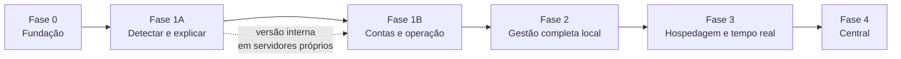

# Plano de implementação — Plataforma de segurança para servidores Linux

> **Versão 1.1 · 22/10/2026 · Status: proposta.** Produto: **VigiaHost** (`vigiahost`). Acompanha o [escopo v2.2](escopo-v2.md) e as [decisões de arquitetura](decisoes-arquitetura.md).
> Tamanhos relativos por épico: **P** (pequeno), **M** (médio), **G** (grande), **GG** (muito grande). Prazos dependem do tamanho da equipe, ainda não definido, e não foram estimados.

---

## 1. Decisões necessárias antes da Fase 0

**Decididas em 22/10/2026**

| Decisão | Resultado |
|---|---|
| Nome do produto | **VigiaHost**; identificador técnico `vigiahost` (binários `vigiahost` e `vigiahost-executor`, serviços `vigiahost-core` e `vigiahost-executor`, usuário `vigiahost`, unidades `vigiahost-run-<id>`) |
| Licença | **Proprietária**, código fechado, venda por licença comercial |
| Repositório | Organização `vigiahost` no GitHub, **plano Team**; repositório privado `vigiahost/vigiahost`; repositório público `vigiahost/pacotes` só para distribuição a partir do beta externo |
| Distribuição | **Somente GitHub por enquanto**: Releases privados na fase interna; Pages do repositório de distribuição no beta externo (escopo, seção 15) |
| Custódia das chaves | **Raiz GPG offline em dois tokens de hardware** com dois responsáveis; subchave anual e chave do cosign no *environment* `release` do CI |

**Ações para começar a Fase 0** (todas suas, porque envolvem contas, compras ou dados de pessoas)

| Ação | Por quê |
|---|---|
| Criar a organização `vigiahost` no GitHub e assinar o plano Team | Reserva o nome; o plano é necessário para proteger a branch e exigir revisão em repositório privado |
| Indicar os dois responsáveis pelas chaves | Cada um guarda um token em local diferente |
| Comprar dois tokens de hardware com OpenPGP e RSA 4096 (ex.: YubiKey 5) | Guardar a chave raiz |
| Encomendar a busca de marca no INPI (classes 9 e 42) | Confirmar que o nome pode ser registrado antes do beta externo |

**Ainda em aberto**

| Decisão | O que ela bloqueia | Recomendação |
|---|---|---|
| Domínio próprio | Beta externo (fim da 1B) | Registrar `vigiahost.com.br` e `vigiahost.com` antes do beta; estavam livres em 22/10/2026 |
| Fonte padrão de regras YARA | Épico E1.4 | YARA Forge core + regras próprias, após validar licenças |
| Papel do LMD | Épico E1.10 | Medir a sobreposição no laboratório durante a 1A e decidir antes da 1B |
| Central multiempresa | Acesso de revendedores e clientes (Fase 3) | Decidir antes da Fase 3 |
| Termos de licença (EULA) e modelo de cobrança | Beta externo | Redigir com apoio jurídico durante a 1B |

---

## 2. Sequência das fases

**Trilhas que avançam em paralelo dentro de cada fase**: executor e política; core (API, fila, agendador, banco); motores e inspetor; interface e design system; empacotamento e instalação; laboratório e qualidade. O laboratório de VMs e o corpus de testes vêm primeiro, porque quase todos os critérios de saída dependem deles.

---

## 3. Fases e épicos

### Fase 0 — Fundação

**Objetivo**: ter o caminho completo do código ao pacote assinado instalado, antes de qualquer funcionalidade.

| Épico | Entregas | Tamanho | Depende de |
|---|---|---|---|
| E0.1 Repositório e CI seguro | Monorepo Go + web, lint, testes com `-race`, *fuzzing* curto, SAST, varredura de segredos e de licenças, *actions* fixadas por SHA, permissões mínimas | M | Decisões de repositório e licença |
| E0.2 Pipeline de release | GoReleaser + nFPM, pacotes DEB/RPM assinados, cosign, SBOM, proveniência, publicação nos Releases privados, `SHA256SUMS` assinado, metadados APT/DNF gerados (publicação no Pages fica para o beta), script de bootstrap assinado, pacote vazio | G | Organização no GitHub, tokens e cerimônia das chaves |
| E0.7 Cerimônia das chaves | Geração da raiz offline, gravação nos dois tokens, cópia cifrada, certificado de revogação, subchave e chave do cosign no CI, ata | P | Tokens comprados e responsáveis indicados |
| E0.3 Laboratório e corpus | VMs do nível 1 (x86_64 e ARM64), controles positivos inofensivos, corpus benigno de CMS, corpus sintético de 1 milhão de arquivos, cenário `memfd` de laboratório | G | — |
| E0.4 Contrato e esqueleto | OpenAPI inicial, cliente TypeScript gerado, esqueleto do core e do executor com *handshake* versionado, Goose e sqlc | M | E0.1 |
| E0.5 Modelo de ameaças e ADRs | Ameaças por limite de confiança (navegador, core, executor, unidades, motores, terceiros); ADRs 001 a 013 aceitos | P | — |
| E0.6 Design system base | Tokens claro/escuro, glossário pt-BR, navegação agrupada, componentes de domínio básicos, catálogo com teste de acessibilidade | M | E0.1 |

**Critério de saída**: pacote vazio instala, atualiza, volta de versão e remove nas distribuições do nível 1; CI verde com todos os critérios da seção 4; ADRs aceitos.

### Fase 1A — Detectar e explicar

**Objetivo**: primeira versão útil, somente leitura, usada internamente em servidores próprios.

| Épico | Entregas | Tamanho | Depende de |
|---|---|---|---|
| E1.1 Executor e política | Socket Unix com `SO_PEERCRED`, operações tipadas, política de caminhos, auditoria no journal, unidades transitórias via D-Bus, travas de recursos | G | E0.4 |
| E1.2 Core | Autenticação (senha + TOTP), sessões, perfis, fila com *lease* e idempotência, agendador orientado ao banco, SSE | G | E0.4 |
| E1.3 Inventário e cache | Percurso único, classificação por conteúdo, cache por inode/`ctime`/versão, deduplicação por hash, ordem por risco | G | E1.1 |
| E1.4 Motores | Cliente nativo do clamd (FILDES), YARA-X via CLI com regras curadas e roteamento por tipo, autoteste com controles positivos, fila de arquivos grandes | G | E1.3 |
| E1.5 Inspetor | Processos (`memfd`, apagados, fora de pacote), cgroup → unidade, rede por processo, inventário de persistência com diferença | G | E1.1 |
| E1.6 Resultados | Objetos, localizações, achados com ciclo de vida, cobertura por motor, correlação por fonte de assinatura | M | E1.4, E1.5 |
| E1.7 Instalação | `setup plan/apply` com manifesto, `doctor`, desinstalação com e sem `--purge`, token de primeiro acesso | M | E0.2 |
| E1.8 Interface 1A | Visão geral, Execuções, Achados, Processos e persistência, Cobertura, Recursos (perfis padrão), estados vazio/carregando/erro | G | E0.6, E1.2 |

**Critério de saída**: detecta os controles positivos e o cenário `memfd` de laboratório; cobertura exibida; reinício no meio da execução sem duplicação; travas de recursos não contornáveis pela API; versão interna instalada em servidores próprios.

### Fase 1B — Contas e operação

| Épico | Entregas | Tamanho | Depende de |
|---|---|---|---|
| E1.9 Contas | Descoberta por `getent passwd`/`UID_MIN`, agregação por UID e caminho, escopo por conta, tela Contas e detalhe, agendamento por conta | G | E1.6 |
| E1.10 LMD 2.0 | Adaptador com `--json-report`, lista do inventário, estágio ClamAV desligado | M | Decisão do papel do LMD |
| E1.11 Exceções | Por hash, hash + regra, regra + prefixo; validade, justificativa e auditoria | M | E1.6 |
| E1.12 Notificações | E-mail e webhook assinado com caixa de saída, deduplicação e botão de teste | M | E1.2 |
| E1.13 Recursos avançados | Perfis próprios, sugestão pelo hardware, ajuste em tempo real, limitação por PSI, métricas de desempenho por execução | M | E1.1 |
| E1.14 Backup | `VACUUM INTO`, configurações e manifestos; restauração testada no CI | P | E1.2 |

**Critério de saída**: escopo por conta correto em laboratório com 500 contas; rotina diária incremental dentro da janela no servidor de referência; primeira versão no canal beta.

### Fase 2 — Gestão completa local

| Épico | Tamanho | Observação |
|---|---|---|
| E2.1 AIDE com triagem automática | G | Configuração dedicada, JSON ≥ 0.18, aprovação da referência |
| E2.2 Verificação contra pacote assinado | M | Base para a triagem do AIDE e do Chkrootkit |
| E2.3 Chkrootkit, Lynis e auditd | M | Base de falsos positivos validada por contexto |
| E2.4 Correções pendentes, serviços a reiniciar, processos e portas ocultos | M | Nativos ou do gerenciador de pacotes |
| E2.5 Quarentena, restauração e ações de resposta | G | Maior risco técnico da fase: testes de corrida obrigatórios |
| E2.6 Passkeys, Telegram, SIEM e backups cifrados | M | — |
| E2.7 Promoção de regras e otimizações da fase | M | Paralelismo adaptativo, regras lentas, conhecidos por proveniência de pacotes |
| E2.8 TUF para tarball e políticas SELinux/AppArmor | M | Testes em modo *enforcing* |

**Critério de saída**: quarentena aprovada nos testes de corrida; triagem do AIDE explica alterações de pacotes atualizados; candidata à versão 1.0 estável.

### Fase 3 — Hospedagem e tempo real

| Épico | Tamanho | Observação |
|---|---|---|
| E3.1 Adaptadores de painéis | GG | Webuzo primeiro, depois os de maior base instalada |
| E3.2 Acesso de revendedor e cliente | G | Depende da decisão sobre multiempresa |
| E3.3 Verificações de hospedagem e integridade de CMS | G | Começa pelo WordPress |
| E3.4 OSV-Scanner, Wordfence Intelligence e logs de acesso | M | Consultas locais; chaves como segredos |
| E3.5 Falco e abuse.ch opcionais | M | Desligados por padrão |
| E3.6 Monitoramento contínuo e memória por PID | G | fanotify com reconciliação; YARA 4.x para memória |

**Critério de saída**: homologação em pelo menos dois painéis; nenhum vazamento entre contas nos testes de autorização.

### Fase 4 — Central

| Épico | Tamanho | Observação |
|---|---|---|
| E4.1 Cadastro, mTLS e revogação de agentes | G | Certificados de curta duração |
| E4.2 Protocolo, caixa de saída e sincronização | G | Entrega "pelo menos uma vez" com deduplicação |
| E4.3 Políticas por grupo, consolidação e ações remotas | GG | Mesma interface React em pacote compartilhado |

**Critério de saída**: agente opera desconectado e sincroniza sem perda nem duplicação.

---

## 4. Critérios de qualidade

**Em cada PR**

- Lint, testes com `-race`, *fuzzing* curto, SAST, varredura de segredos, govulncheck e osv-scanner sem achados altos ou críticos abertos.
- Cobertura ≥ 80% em política, fila, interpretadores e correlação.
- Revisão obrigatória; alterações no executor, na política ou na autorização exigem um segundo revisor.
- Componentes de interface alterados passam no teste automatizado de acessibilidade.

**No fim de cada fase**

- Modelo de ameaças atualizado com o que a fase acrescentou.
- Revisão de segurança: varredura automatizada do código completo e revisão manual do executor, da política e das rotas de autorização (matriz 100% endpoint × perfil, e perfil × conta a partir da Fase 3).
- Testes de resiliência (`kill -9`, disco cheio, banco travado, salto de relógio) e testes em VM em todas as distribuições do nível 1, inclusive SELinux *enforcing* e AppArmor.
- Auditoria manual de acessibilidade com teclado e leitor de tela; teste de uso com dois ou três administradores de servidor.
- Desempenho comparado com a fase anterior no corpus de referência.
- Documentação de instalação, operação e solução de problemas atualizada.
- **Antes da 1.0 estável**: teste de intrusão independente (decisão de custo pendente).

---

## 5. Checklist de release

**Antes de publicar**

- [ ] CI verde em todos os critérios da seção 4.
- [ ] Mudanças no executor, na política ou na autorização revisadas por duas pessoas.
- [ ] Migrações seguem expandir/contrair; testados atualização N-1 → N, retorno N → N-1 e atualização com banco grande (1 milhão de objetos).
- [ ] Backup automático antes da migração e restauração testados.
- [ ] Testes em VM: instalação limpa, atualização, retorno, reexecução do `setup apply`, desinstalação com e sem `--purge`, SELinux *enforcing* e AppArmor.
- [ ] *Handshake* core–executor testado com a versão anterior.
- [ ] Pacotes assinados, cosign, SBOM, proveniência, hashes e script de bootstrap assinados publicados.
- [ ] Notas de release com mudanças, migrações, ações necessárias e compatibilidade de motores.
- [ ] Plano de retorno revisado.

**Publicação**

- [ ] Canal beta primeiro; instalação nos servidores próprios de homologação.
- [ ] Observação no beta (sugestão: 7 dias para releases com migração): execuções com falha, falha de motor, cobertura, consumo ocioso, duração das varreduras e erros no journal.
- [ ] Promoção para o canal estável somente com autorização do responsável pelo produto.

**Depois de publicar**

- [ ] Acompanhar relatos e métricas dos servidores próprios.
- [ ] Atualizar a matriz de compatibilidade e a documentação.

**Gatilhos de retorno à versão anterior**

- Falha de instalação ou atualização em qualquer distribuição do nível 1.
- Executor recusando operação legítima ou aceitando operação fora da política.
- Aumento de "falha de motor" ou cobertura menor que a da versão anterior.
- Consumo ocioso acima da meta (100 MiB) ou degradação perceptível da latência dos sites.
- Migração com falha ou banco corrompido.

**Como retornar**: rebaixar o pacote para a versão anterior, mantida no repositório; o esquema expandir/contrair mantém o banco compatível. A restauração do backup fica para o caso de migração interrompida no meio.

---

## 6. Próximos passos

1. Aprovar o escopo v2.2 e os ADRs propostos.
2. Executar as ações da seção 1: organização no GitHub com plano Team, responsáveis pelas chaves, tokens e busca no INPI.
3. Iniciar a Fase 0 pelos épicos E0.3 (laboratório e corpus) e E0.1 (repositório e CI), que destravam todos os outros; E0.7 assim que os tokens chegarem.
